<!-- Hero Banner Asset -->

 

<!-- Dynamic Typing Headline -->

 

<!-- Status and Quick Info Badges -->

  
  
  
  

<!-- Section Divider -->

## 👨‍💻 About Me

I am a **Full-Stack Software Engineer** and **Software Engineering student at Adama Science and Technology University (ASTU)** with a deep passion for building high-performance web applications, robust distributed backends, and real-time interactive systems.

- 🎓 **Education**: B.Sc. in Software Engineering, School of Electrical Engineering & Computing, Adama Science and Technology University (ASTU).
- ⚡ **Core Philosophy**: Clean architecture, type safety, modular microservices, and relentless focus on user experience.
- 🚀 **Specializations**: Real-time WebSocket architectures, full-stack enterprise portals (Next.js / React / NestJS), resilient databases (PostgreSQL / MongoDB), and applied Machine Learning pipelines.
- 🌐 **Interests**: Cloud-native architectures, IoT mesh networks (ESP-NOW / SafeMesh), AI conversational agents, and competitive system performance.

  

## 🛠️ Technical Arsenal

### Frontend & UI Engineering

  
  
  
  
  
  
  
  

### Backend, APIs & Real-Time

  
  
  
  
  
  
  

### Databases & ORMs

  
  
  
  
  

### Machine Learning, IoT & Systems

  
  
  
  
  

### DevOps, Cloud & Tooling

  
  
  
  
  
  

  

## 🌟 Featured Projects

<table>
  <tr>
    <td width="50%" valign="top">
      <h3 align="left">🎮 Word Battle — Real-Time Multiplayer Duel Platform</h3>
      

        A real-time competitive multiplayer word battle and typing race platform engineered as a seamless <b>Telegram Mini App</b>. Features millisecond-precision WebSocket gameplay, automated matchmaking queues, private rooms with invite links, solo practice modes, and global Elo leaderboards.
      

      

        <b>Tech Stack:</b> <code>Next.js 14</code> • <code>NestJS 10</code> • <code>Socket.io</code> • <code>TypeORM</code> • <code>PostgreSQL</code> • <code>TailwindCSS</code> • <code>Vercel Serverless</code>
      

      

        ✨ <i>Features: Telegram HMAC auth, real-time 1v1 state synchronization, weekly podiums, serverless database pooling.</i>
      

    </td>
    <td width="50%" valign="top">
      <h3 align="left">🧾 <a href="https://github.com/Amanbey/Invoices-tracking-web-app">Invoice &amp; Payment Tracking System</a></h3>
      

        A feature-packed full-stack enterprise financial ledger designed to automate billing, track client invoice lifecycles, and monitor payment completion statuses with audit logging and secure authentication.
      

      

        <b>Tech Stack:</b> <code>Next.js 14</code> • <code>React 18</code> • <code>Node.js</code> • <code>Express</code> • <code>MongoDB</code> • <code>Mongoose</code> • <code>JWT</code> • <code>Helmet</code>
      

      

        ✨ <i>Features: Role-based authorization, rate-limited secure REST API, PDF invoice attachments, automated status transitions.</i>
      

      

        <a href="https://github.com/Amanbey/Invoices-tracking-web-app"><b>Explore Repository →</b></a>
      

    </td>
  </tr>
  <tr>
    <td width="50%" valign="top">
      <h3 align="left">💊 <a href="https://github.com/Amanbey/pharmacy-management-system">Pharmacy &amp; Inventory Management System</a></h3>
      

        Comprehensive healthcare inventory and dispensary portal built to streamline pharmaceutical stock tracking, monitor medicine expiry dates, manage prescriptions, and analyze sales performance.
      

      

        <b>Tech Stack:</b> <code>React 19</code> • <code>Vite</code> • <code>TailwindCSS v4</code> • <code>Recharts</code> • <code>Node.js</code> • <code>Express 5</code> • <code>MongoDB</code>
      

      

        ✨ <i>Features: Interactive sales analytics dashboards, low-stock notifications, prescription records, staff access tiers.</i>
      

      

        <a href="https://github.com/Amanbey/pharmacy-management-system"><b>Explore Repository →</b></a>
      

    </td>
    <td width="50%" valign="top">
      <h3 align="left">📡 <a href="https://github.com/Amanbey/SafeMesh">SafeMesh — Off-Grid Disaster Mesh Network</a></h3>
      

        Low-cost decentralized peer-to-peer mesh networking solution for disaster recovery and emergency response scenarios where conventional internet and cellular infrastructure are unavailable.
      

      

        <b>Tech Stack:</b> <code>ESP32</code> • <code>ESP-NOW Protocol</code> • <code>Svelte</code> • <code>TypeScript</code> • <code>Vite</code>
      

      

        ✨ <i>Features: Multi-hop packet relaying, SOS emergency alerts with GPS coordinates, live browser telemetry dashboard.</i>
      

      

        <a href="https://github.com/Amanbey/SafeMesh"><b>Explore Repository →</b></a>
      

    </td>
  </tr>
  <tr>
    <td width="50%" valign="top">
      <h3 align="left">🤖 <a href="https://github.com/Amanbey/spam-email-classifier">Spam Email &amp; SMS Classifier</a></h3>
      

        End-to-end Machine Learning natural language processing classifier that identifies spam messages using TF-IDF feature extraction and trained classification models with serialized artifacts.
      

      

        <b>Tech Stack:</b> <code>Python 3.9+</code> • <code>Scikit-Learn</code> • <code>Pandas</code> • <code>NumPy</code> • <code>TF-IDF</code>
      

      

        ✨ <i>Features: 98%+ validation accuracy, confusion matrix metrics, interactive custom text inference engine.</i>
      

      

        <a href="https://github.com/Amanbey/spam-email-classifier"><b>Explore Repository →</b></a>
      

    </td>
    <td width="50%" valign="top">
      <h3 align="left">⚡ Telegram AI Business Assistant</h3>
      

        Autonomous conversational AI assistant engineered for Telegram business accounts to automate client onboarding, answer inquiries 24/7, and manage sales leads through webhook workflows.
      

      

        <b>Tech Stack:</b> <code>Node.js</code> • <code>Express 5</code> • <code>grammY</code> • <code>OpenAI API</code> • <code>Helmet</code>
      

      

        ✨ <i>Features: Context-aware prompt orchestration, rate-limited webhook endpoints, automated lead classification.</i>
      

    </td>
  </tr>
</table>

  

## 📊 GitHub & Engineering Statistics

<table border="0">
  <tr>
    <td align="center">
      
    </td>
    <td align="center">
      
    </td>
  </tr>
  <tr>
    <td colspan="2" align="center">
      
    </td>
  </tr>
</table>

  

## 📬 Connect & Collaborate

Whether you're looking to discuss full-stack engineering opportunities, collaborate on innovative open-source projects, or build something extraordinary together, I'd love to connect!

  
  
  
  

  📍 <b>Based in Ethiopia</b> • 🎓 <b>Adama Science and Technology University (ASTU)</b> • ⚡ <b>Available for Worldwide Remote Roles</b>

 

  Designed &amp; crafted with precision for <b>Aman Abdela</b> • © 2026. All rights reserved.

